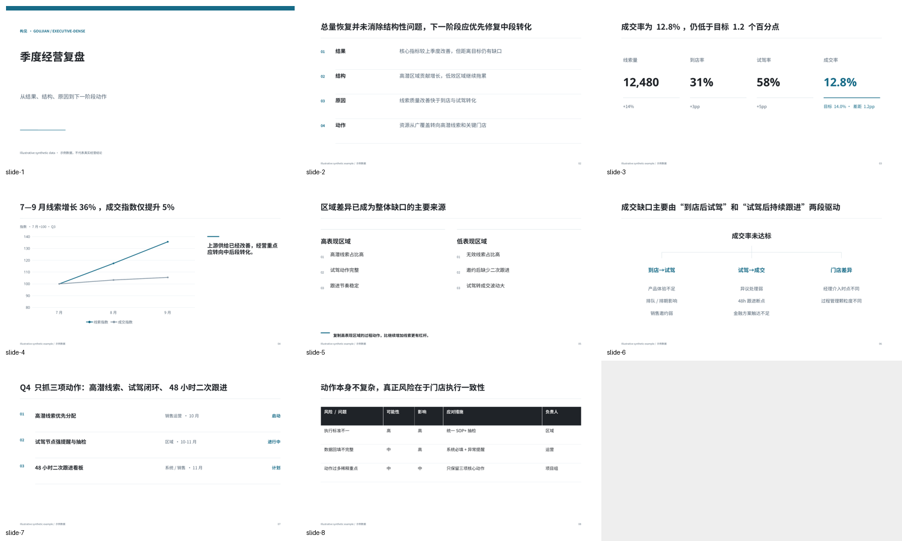

# Goujian Strategy Slides

[English](README.en.md) | [简体中文](README.md)（默认）

**构见·战略演示 · Presentation Intelligence for AI Agents**

**Think clearly. Structure strategically. Present decisively.**

Goujian Strategy Slides is an open-source, production-oriented presentation skill designed to help AI agents turn complex information into clear, structured and decision-useful presentations.

Instead of treating presentation creation as a text-to-slide task, Goujian models the reasoning behind professional presentations:

**Think → Structure → Visualize → Build → Validate**

It combines management storytelling, storyline planning, semantic archetypes, reusable compositions, visualization logic, profile-driven design, native editable PPTX generation and quality validation. The AI agent supplies judgment; executable code builds and checks a bounded presentation spec.

> Great presentations are not collections of beautiful slides. They are structured arguments designed to make complex information understandable and actionable.

**Question → Evidence → Judgment → Action** · **High information density ≠ high text density**



*Rendered V1 example. All examples use illustrative synthetic content, not real business evidence.*

## What V1.1 includes

- 28 management storylines and 15 template recipes for reviews, strategy, research, sales, projects, launches, marketing, technology, training and cost decisions.
- 86 semantic catalog entries: **74 implemented, 6 partial, 6 designed only**. Designed entries are rejected by the builder rather than rendered as a misleading approximation.
- 27 composition recipes routed through 22 reusable rendering functions. Variants share code; these are not 86 independent layouts.
- 15 profiles controlling typography, spacing, title/cover treatment, table headers/banding, metric treatment, chart grids and colors.
- 15 runnable benchmark decks, JSON Schema plus payload validation, geometry/font checks, optional rendering and montage generation.

See the [product overview](docs/PRODUCT_OVERVIEW.md), [feasibility review](docs/FEASIBILITY_REVIEW.md), [library audit](docs/LIBRARY_AUDIT.md) and [visual iterations](docs/VISUAL_REVIEW.md).

## V1.1 multimodal composition and visual intelligence

Four shared compositions connect native images, charts, tables and interpretation. PNG/JPEG/WEBP assets enter PPTX directly; screenshots default to contain, with embedded pixel text distinguished from editable text. Measured titles support `title_short` / `subtitle` and dynamic divider/body flow. A PPTX-hash-bound scene record enables spatial checks for evidence occlusion, text/rule collisions and source relationships.

Asset classification, conclusion rewriting and visual repair remain agent-assisted. There is no automatic OCR, arbitrary lossless PPTX editor or autonomous vision engine. Read the [multimodal contract](docs/MULTIMODAL_CONTRACT.md), [ground truth audit](docs/V1_1_GROUND_TRUTH.md) and [current validation](docs/V1_1_VALIDATION.md).

## Runnable analytics

Replace JSON inputs for Business Performance, nonlinear Sales Conversion and Project Analytics. Three executable families cover 18 tasks, with strict schemas, unit/window/denominator rules, null handling, reconciliation, explicit splitting and native data-fidelity checks. Trial is optional; association never implies causal lift. The first project contract uses CNY cumulative snapshots. See [inputs, formulas and commands](docs/ANALYTICAL_LIBRARY.md).

```bash
npm run analyze:business
npm run analyze:sales
npm run analyze:project
```

Integrated native dashboards, decision explanations and local soft image scrims strengthen existing compositions without expanding template/profile counts. See [final validation and before/after](docs/V1_1_RELEASE_VALIDATION.md).

## Installation

Use **Node.js 18+ and Python 3.9+** with `node`, `npm` and `python3` on PATH. Images and the complete tests require Pillow; local glyph measurement uses Fontconfig. Basic geometry checks use the standard library. Clone the complete repository; copying `skill/` alone does not install the runtime.

The [v1.1.0 release ZIP](https://github.com/one-drop888/goujian-strategy-slides/releases/tag/v1.1.0) extracts to one `goujian-strategy-slides/` folder with a single Skill entry at its root, `SKILL.md`. Upload the complete ZIP to a Skill platform; if it extracts archives itself, use that folder as the Skill root. Platform import and security scanning still require a test on the target platform.

```bash
git clone https://github.com/one-drop888/goujian-strategy-slides.git
cd goujian-strategy-slides
python3 -m venv .venv
. .venv/bin/activate
python3 -m pip install -r requirements-render.txt
npm install
npm test
npm run validate:example
npm run build:example
npm run qa:example
```

The PPTX is written to `out/executive-review.pptx`; QA is written to `out/quality-report.json`. `npm ci` reproduces the committed dependency lockfile. No npm registry publication is required.

Core build/validation works without render tools. `qa:example` attempts rendering and reports `UNAVAILABLE` when dependencies are missing; this is **not** a visual pass. Install render dependencies before inspecting output:

```bash
python3 -m venv .venv
# Linux/macOS: activate this environment in your shell
. .venv/bin/activate
python3 -m pip install -r requirements-render.txt
```

Also install **LibreOffice**, **Poppler** (`pdftoppm`) and the **Noto Sans / Noto Sans CJK SC** font families. For Debian/Ubuntu, system packages are `libreoffice-impress poppler-utils fontconfig fonts-noto-core fonts-noto-cjk`. Fonts are not bundled or embedded. A custom profile can name other installed fonts.

Linux was tested locally. macOS needs these executables on PATH. For Windows, use WSL2 for the documented `python3` commands; native Windows and PowerPoint/macOS rendering have not been validated. Font QA uses `fc-list`; without Fontconfig, it reports `UNAVAILABLE`.

## Use with an AI agent

Install or expose the **whole repository folder** to your agent's skill discovery mechanism, then load the root [SKILL.md](SKILL.md). Adapters are instructions, not tested platform integrations. Ask the agent to establish the decision, evidence and uncertainty, then author a [semantic spec](docs/SPEC_CONTRACT.md).

```bash
node skill/scripts/build_deck.js skill/examples/executive-review.json out/review.pptx --profile consulting
npm run library
npm run benchmark
npm run benchmark -- --render
```

`benchmark` builds and audits all 15 scenarios. Add `--render` for PNG pages and montages. Inspect them before recording visual approval. Each scenario preserves a QA report and PPTX hash under `out/benchmarks/`.

[Custom profiles](docs/CUSTOM_PROFILE_GUIDE.md) inherit from built-ins. [Existing PPTX workflows](docs/EXISTING_PPTX_WORKFLOW.md) cover bounded text editing, inspection and reference-based reconstruction.

## Capability boundaries

| Capability | V1 status | What actually runs |
|---|---|---|
| Create | Implemented | Validated semantic JSON → native editable PPTX |
| Edit | Partial | Replace text within individual text nodes; no intelligent reflow |
| Rebuild | Partial | Agent inspects source and authors a new spec; no lossless converter |
| Template reuse | Partial | Storyline/profile recipes; no imported master/layout fidelity |
| Style extraction | Partial | Theme, font and geometry statistics; agent interprets the result |
| Native editable PPTX | Implemented | Text, shapes, tables and supported native charts |
| Overflow / overlap | Partial | Bounding boxes and peer-overlap candidates; no exact text-fit proof |
| Font QA | Partial | Font-family availability on this host; not glyph coverage or embedding |
| Render / montage | Implemented, optional | LibreOffice → PDF → PNG; Pillow montage |
| Visual QA | Partial | Human/vision-agent inspection with a hash-bound review record |
| Repair loop | Partial | Agent changes spec/code and rerenders; no automatic visual repair engine |
| Planner | Partial | Keyword routing helpers; evidence reasoning remains the agent's work |
| HTML renderer | Designed | No HTML output in V1 |

Waterfall/bridge, combo, scatter/bubble, heatmap have no faithful V1 renderer. Abstract map/relationship/Sankey-like entries are explicitly partial. Canvas support is 16:9 only. Long content must be split or edited; passing a capacity check does not prove readability.

## Architecture and contributing

```text
Agent reasoning → Presentation Spec → Storyline / Archetype → Composition + Profile
                                                               ↓
                                                        PPTX Renderer → QA → Review
```

The planning and composition layers do not import PptxGenJS. Rendering coordinates remain in the PPTX backend; a shared cross-renderer layout engine is future work. See [architecture](docs/architecture/ARCHITECTURE.md) and [contributing](CONTRIBUTING.md).

There is **one product and one Presentation Library** across agent runtimes. Platform adapters reuse it rather than maintaining separate editions.

## License

[Apache-2.0](LICENSE). Runtime dependencies retain their own licenses; see [third-party notices](THIRD_PARTY_NOTICE.md). No commercial templates, copied benchmark code or proprietary visual assets are included. Do not publish private source decks or unlicensed fonts/assets.
