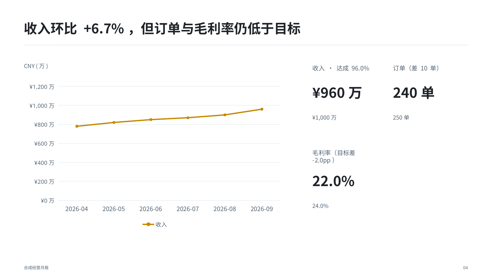

# Goujian Strategy Slides｜构见·战略演示

[简体中文（本页）](README.md) · [简体中文镜像](README.zh-CN.md) · [English](README.en.md) · [安装](#安装) · [案例与验证](docs/BENCHMARKS_V1_3.md)

**面向 AI Agent 的 Presentation Intelligence**

Think clearly. Structure strategically. Present decisively.

构见把复杂材料组织成有证据、有判断、可行动的演示文稿。Agent 负责分析和设计，程序负责数值校验、排版、原生可编辑 PPTX 构建与质量检查。适用于经营复盘、销售诊断、战略研究、项目绩效和技术方案。

**Think → Structure → Visualize → Build → Validate**

**Question → Evidence → Judgment → Action**

> 好的演示文稿不是漂亮页面的集合，而是一套帮助人理解复杂问题，并形成判断与行动的结构化论证。

高信息密度 ≠ 高文字密度。



*项目自有合成数据，来自 V1.3 原生 PPTX 的实际渲染；[案例与验证范围](docs/BENCHMARKS_V1_3.md)。*

## V1.3：分析与视觉智能

- **数字有明确语义。** 区分原始比例、百分数和百分点；统一金额缩放、精度、缺失值与科学计数。一个指标可以同时驱动标题、KPI、图表和表格，转换过程留有记录。
- **图表围绕比较目的设计。** 原生柱、条、线、面积、饼及环图支持不同的系列编码。实际、目标和历史可以用颜色、线型与 Marker 区分；重点由作者指定。等宽直方图要求真实数值分箱，不把普通类别图冒充统计图。
- **整份汇报有可追踪的论证。** Reasoning Plan 记录来源、主张、计算与内容取舍；可选 Narrative Graph 连接问题、证据、页面和决策。重复候选交给 Agent 审阅，保留有效的摘要与展开。
- **标题和证据共同占用页面。** 测量可读的单行候选，再选择均衡两行。图片、图表、文字与标注共享组合；截图保留像素证据，新增文字、表格和已支持图表保持原生可编辑。
- **验证针对实际产物。** Quality Gate 结合 Spec、PPTX/工作簿回读、几何、字体、空间检查及渲染。视觉通过需要对最终页面的独立复核，不能由文件生成成功代替。

方法：**数据语义准确 → 图形编码正确 → 视觉快速识别 → 支持管理判断**。

[真实生成案例与对照](docs/BENCHMARKS_V1_3.md) · [产品介绍](docs/PRODUCT_OVERVIEW.zh-CN.md) · [可行性与验收范围](docs/FEASIBILITY_REVIEW.zh-CN.md) · [从 V1.2.1 迁移](docs/MIGRATION_V1_3.md)

## 安装

核心兼容 Node.js18+、Python3.9+；建议使用仍在维护的 Node LTS（24）与受支持的 Python 安全补丁版本。**图片处理、像素文字测量和完整渲染需 Python3.11+ / Pillow13**；旧 Python 可运行无 Pillow 的核心层。完整安装整个仓库，不要只复制 `skill/`。

```bash
git clone https://github.com/one-drop888/goujian-strategy-slides.git
cd goujian-strategy-slides
npm run bootstrap -- --dry-run --json
npm run bootstrap
. .venv/bin/activate
npm run doctor -- --json
npm test
npm run validate:example
npm run build:example
npm run qa:example
```

Bootstrap 只安装项目 npm 依赖并创建本地 `.venv`，不安装系统工具。PowerShell 使用 `.\.venv\Scripts\Activate.ps1` 激活；如需选择解释器，运行 `npm run bootstrap -- --python /path/to/python3.11`。Python3.9/3.10 核心层使用 `npm run test:core`。

实际渲染另需 LibreOffice、Poppler 和字体（默认 Noto Sans / Noto Sans CJK SC）。[安装与恢复](docs/INSTALLATION.md)说明各平台依赖；Doctor 报告可用性，不代表已经渲染或通过视觉检查。

也可从 [GitHub Releases](https://github.com/one-drop888/goujian-strategy-slides/releases) 下载带 SHA256 的安装 ZIP。解压后进入 `goujian-strategy-slides/`，在 Agent 平台中发现该目录唯一的根 `SKILL.md`，运行上述安装步骤。所有 Agent 平台使用同一套开源内核，无需公司专用分支。

V1.3.1 是企业安全兼容补丁：主安装包为精简运行时，另提供完整源码包与可选评审包；产品能力、原生渲染和历史验收证据不变。公司平台与 Agensi 仍未实际验收，`COMPANY_PLATFORM_SECURITY=NOT_VERIFIED`。[补丁说明](docs/V1_3_1_RELEASE_NOTES.md) · [安全与能力对等](docs/SECURITY_PARITY_V1_3_1.md)

## 用起来

先确定受众和决策问题，再交给 Agent 读取 `SKILL.md`。可以从一份分析输入、可审阅的推理计划，或现有 JSON Spec 开始：

```bash
# 三类可替换数据的分析 Recipe
npm run analyze:business
npm run analyze:sales
npm run analyze:project

# Agent 编写计划；程序校验来源、算术和绑定，再构建
node skill/scripts/validate_plan.js skill/reasoning/fixtures/q4-six-actions/plan.json --json
node skill/scripts/compile_plan.js skill/reasoning/fixtures/q4-six-actions/plan.json --out out/q4.pptx --spec-out out/q4.spec.json

# 原始 Spec → PPTX → 实际渲染
node skill/scripts/build_deck.js skill/examples/executive-review.json out/review.pptx
python3 skill/scripts/quality_gate.py out/review.pptx --spec skill/examples/executive-review.json --out out/review-qa.json --render-dir out/review-render
```

分析 Recipe 校验时间窗口、分母、去重、成熟队列和汇总关系。试驾等行为是可选分支，相关性不等于因果。数据缺失会保留并报告；容量不足时拆页或要求调整，不静默删列。详见[分析输入](docs/ANALYTICAL_LIBRARY.md)、[数值与视觉契约](skill/references/analytical-visual-intelligence.md)、[叙事图](skill/references/narrative-graph.md)。

保留原始 Spec、来源、PPTX、场景和 QA。`effective_spec` 是已经转换过的内部构建结果，不要作为新的输入重复缩放。修改内容后重新构建、渲染和审阅；旧文件的视觉签名不能批准新文件。

## 能力边界

| 能力 | 当前范围 |
|---|---|
| 新建与重建 | Agent 组织信息并编写 Spec/Plan；不是内置的通用源文档推理模型 |
| 原生编辑 | 文本、形状、表格、已支持图表可编辑；图片中的像素文字不可编辑 |
| 已有 PPTX | 支持单 DrawingML 文本节点替换；复杂重建与参考风格分析仍需 Agent；无任意无损回写 |
| 图表 | 六类原生家族，柱/条堆叠与显式等宽分箱；含缺失值或不足两个数据点的面积图须改用折线图、KPI 或表格；散点、气泡、瀑布、双轴/组合图尚未实现，须用语义合适的替代方案 |
| 来源与判断 | 结构化源字节/算术可核对；来源真实性、因果、统计显著性和商业判断仍需审阅 |
| 视觉 QA | 结构检测 + 真实渲染 + 复核者记录；无全自动审美批准或确定性视觉修复 |
| 运行平台 | Linux 实际执行范围见验收报告；Windows/macOS/ARM64 原生 PowerPoint 尚未验证 |
| 分发安全 | 安装 ZIP 有完整性和静态安全预检；公司平台、Agensi 的实际审核另行验证 |

V1.3 核心继续采用 **Apache-2.0**。Goujian Pro 是独立设计中的专业扩展，不是已可购买的功能，也不会把既有错误修复移到付费层。[许可证](LICENSE) · [第三方说明](THIRD_PARTY_NOTICE.md) · [变更记录](CHANGELOG.md)
