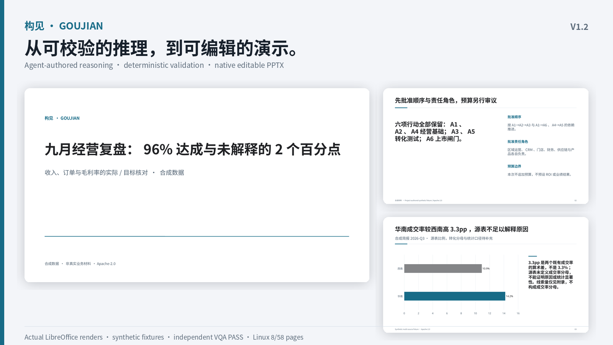

# Goujian Strategy Slides｜构见·战略演示

[简体中文（本页）](README.md) · [简体中文镜像](README.zh-CN.md) · [English](README.en.md) · [安装](#安装) · [推理计划](#推理计划agent-判断确定性校验) · [能力边界](#能力边界) · [Benchmark A–J](docs/BENCHMARKS_V1_2.md)

**面向 AI Agent 的 Presentation Intelligence**

**Think clearly. Structure strategically. Present decisively.**

构见·战略演示是一套面向 AI Agent 的开源演示文稿智能 Skill。它把一份高质量商业汇报背后的思考过程产品化：

**思考 → 结构 → 可视化 → 构建 → 验证**

将管理叙事、Storyline、Action Title、Semantic Archetype、Composition Grammar、数据可视化、Profile 驱动设计、原生可编辑 PPTX 与 Quality Gate 整合为统一流程。Agent 负责判断，确定性代码负责校验、构建和暴露边界。

> 好的演示文稿不是漂亮页面的集合，而是一套帮助人理解复杂问题，并形成判断与行动的结构化论证。

**Question → Evidence → Judgment → Action**

**问题 → 证据 → 判断 → 行动** · **高信息密度 ≠ 高文字密度**



*V1.2 实际 LibreOffice 渲染，全部为合成或项目自有示例，不代表真实经营事实。*

## V1.2 提供什么

- **Reasoning Plan**：把来源、主张、内容取舍、确定性计算、数字绑定和主题决策写成可校验的 JSON，再编译为原生可编辑 PPTX、导出 Spec、哈希绑定的场景与推理 sidecar。
- **确定性校验边界**：支持 `sum`、`difference`、`ratio`、`percent_change`；检查单位、时间窗口、指标、分母和零值。没有通用公式引擎、统计显著性检验或因果推断。
- **来源核对分层**：结构化 JSON 来源可用 JSON Pointer 对照源字节；PDF、图片、文本和原生 PPTX 的数值台账仍需复核者提取与核对，不把“已引用”当作“已证实”。
- **主题决策**：reference / brand / explicit user / automatic / default 的优先级有记录，dark 模式与 printable 冲突会显式记录，三条主题变体已完成实际渲染。
- **八个展示案例**：三套 reasoning deck、三套主题变体、八类深色原生图表诊断和长标题回归；每例包含输入参考、导出 Spec、PPTX、渲染、QA、哈希清单。详见[展示说明](docs/SHOWCASE_V1_2.md)。
- **可复现打包**：轻量安装 ZIP 只含一个根目录 `SKILL.md`，固定顺序、时间戳和权限；展示 ZIP 单独交付，不进入安装包。
- 28 个管理 Storyline、86 个语义条目（74 IMPLEMENTED / 6 PARTIAL / 6 DESIGNED）、27 个 Composition Recipe、15 个 Profile、15 个 Template Recipe；数量是表达词汇范围，不是 86 套独立版式。

独立最终视觉验收已在写入停止后完成：Codex 检查了 8 个案例的全部 58 页实际 LibreOffice 渲染（Linux x86_64、合成素材），结论为 `PASS_WITH_KNOWN_LIMITATIONS`，并绑定精确 PPTX 与页面 PNG 哈希。该验收不等于出版批准，公开发布尚未执行。

## 推理计划：Agent 判断，确定性校验

```text
Agent 编写来源 / 主张 / 取舍 / 计算 / 数字绑定 / 主题
                    ↓
validate_plan：结构 · 算术 · 引用闭合 · 覆盖 · 绑定 · 主题
                    ↓
compile_plan：导出 Spec → Composition + Profile → 原生 PPTX
                    ↓
Reasoning sidecar · Scene · 内嵌报告 · 结构 QA · 实际渲染
                    ↓
语义与视觉复核者（不是自动批准）
```

计划由 Agent 编写，本项目不内置独立的通用推理模型。校验器只证明其声明的结构与算术在契约内成立；来源真实性、语义忠实度、因果关系、审美和接收端字体效果仍需复核者判断。完整契约、JSON Pointer 与最终哈希校验范围见 [Reasoning Plan 参考](skill/references/reasoning-plan.md)。

```bash
# 只校验
node skill/scripts/validate_plan.js skill/reasoning/fixtures/q4-six-actions/plan.json --json

# 编译；--profile 是显式用户覆盖，--force 只用于替换预期输出
node skill/scripts/compile_plan.js skill/reasoning/fixtures/q4-six-actions/plan.json \
  --out out/q4.pptx --spec-out out/q4.spec.json --profile dark-executive
```

`compile_plan.js` 不覆盖计划、来源文件或素材。失败时先修正计划或来源，再重新校验；不要用 `--force` 绕过冲突。输出包含 PPTX、导出 Spec、`*.pptx.scene.json`、`*.pptx.reasoning.json`、内嵌推理报告和带 claim 追踪的演讲者备注。legacy deck JSON 继续受支持；未使用计划构建的 deck 报告 reasoning `NOT_RUN`。

## 多模态与视觉智能

图片、原生图表、表格与解释通过共享组合连接。PNG/JPEG/WEBP 原生进入 PPTX；截图默认完整保留，像素文字与可编辑文字明确区分。标题按字形宽度测量，支持 `title_short` / `subtitle`、动态分割线和正文流。构建同时输出绑定 PPTX 哈希的场景记录，空间 QA 可检查证据遮挡、文字/横线冲突和来源关系。

资产分类、语义改写与视觉修复仍由 Agent 负责；没有自动 OCR、任意 PPTX 无损编辑、自主视觉推理或跨 Renderer 布局引擎。字体测量是估算，结构 QA 不能证明实际渲染中不存在所有文字碰撞，必须检查最终画面。

业务页副标题使用简短业务语言；`NOT_PROVIDED`、抽取限制等方法状态留在报告、备注或附录，不进入业务副标题。参阅[多模态契约](docs/MULTIMODAL_CONTRACT.md)。

## 安装

需要 **Node.js 18+、Python 3.9+**，并确保 PATH 中有 `node`、`npm`、`python3`。仓库必须完整安装，不能只复制 `skill/`。从仓库根目录运行命令。

```bash
git clone https://github.com/one-drop888/goujian-strategy-slides.git
cd goujian-strategy-slides

# 预览动作；实际执行 npm ci、创建隔离 .venv 并安装 Pillow
npm run bootstrap -- --dry-run --json
npm run bootstrap
. .venv/bin/activate

# 只报告工具存在与版本，不证明执行或视觉通过
npm run doctor -- --json

npm test
npm run validate:example
npm run build:example
npm run qa:example
```

也可手动执行等价流程：

```bash
npm ci
python3 -m venv .venv
. .venv/bin/activate
python3 -m pip install -r requirements-render.txt
```

输出位于 `out/executive-review.pptx` 和 `out/quality-report.json`。`npm ci` 使用仓库内 lockfile 复现依赖，本项目不依赖 npm 包发布。

核心构建、Schema、几何和 PPTX 检查不需要渲染工具。`qa:example` 会尝试渲染；缺少依赖时明确显示 `UNAVAILABLE`，不能当作视觉通过。可选的完整渲染还需要：

- **LibreOffice**（`soffice`）
- **Poppler**（`pdftoppm`）
- **Noto Sans / Noto Sans CJK SC** 字体与 Fontconfig
- Debian/Ubuntu 包名：`libreoffice-impress poppler-utils fontconfig fonts-noto-core fonts-noto-cjk`

字体不随仓库分发，也不会嵌入 PPTX；接收方需安装字体，或改用已安装字体的自定义 Profile。实测主机为 Linux x86_64；macOS 需将工具放入 PATH；Windows 建议使用 WSL2。原生 Windows、macOS、ARM64 与 Microsoft PowerPoint 渲染均为 `NOT_RUN`，不能据此宣称跨平台一致。

### 安装 ZIP 与展示 ZIP

```bash
npm run package            # dist/goujian-strategy-slides-v1.2.0.zip
npm run showcase           # out/v1.2-showcase（可选展示构建）
npm run package:showcase   # dist/goujian-strategy-slides-v1.2.0-showcase.zip
```

安装 ZIP 解压后是一个 `goujian-strategy-slides/` 文件夹，只有根目录一个 [SKILL.md](SKILL.md)，包含完整运行时、示例、Profile、Schema 与测试，不包含 `node_modules/`、`.venv/`、`out/`、缓存或 PPTX。展示 ZIP 是单独的可选复核资产；正常使用不需要它。平台导入与安全扫描仍须在目标平台复测。

V1.2.0 的公开标签与 Release 由独立的发布任务执行，本阶段不推送、不打标签、不发布。发布流程只接受 `workflow_dispatch` 的已批准主分支 SHA，不因普通 push 自动发布。

## Benchmark A–J

| ID | 场景 | 本轮实际执行 |
|---|---|---|
| A | 高管经营复盘（信息不完整） | 7 页 reasoning deck；来源缺口与补数行动显式保留 |
| B | Q4 六项行动 | 6 个行动 ID、3 个分组、4 条依赖边；实际渲染 |
| C | 非线性销售分析 | 既有分析库与 24 项 analytics 测试 |
| D | 多源整合 | 9 列原生表、负责人/复核日、原生图表与截图证据 |
| E | 八类深色原生图表 | 8 页原生图表诊断；已纳入最终独立 58 页 VQA |
| F | 长标题与动态副标题 | 8 页标题/分割线回归 |
| G | 三套主题变体 | light / brand-blue / dark 各 7 页实际渲染 |
| H | 原生来源 PPTX 检查 | 文件/页/形状定位、9 列、图表值与内嵌图片哈希 |
| I | 干净安装与恢复 | Unicode/空格路径、无符号链接、doctor/build/QA 记录 |
| J | Agent 端到端 | Qoder 走通计划、构建、渲染、QA、批评与有限修复 |

逐项证据路径、状态和限制见 [Benchmark A–J](docs/BENCHMARKS_V1_2.md)。A–J 是证据矩阵，不是 “全部视觉通过” 的声明；原生 PowerPoint（macOS/Windows/ARM64）为 `NOT_RUN`，Agensi/公司平台托管运行为 `NOT_VERIFIED`。

## 能力边界

| 能力 | V1.2 状态 | 实际能力 |
|---|---|---|
| Create | 已实现 | 合规语义 JSON → 原生可编辑 PPTX |
| Reasoning Plan | 已实现，契约内 | 结构、算术、引用、覆盖、绑定与主题校验；无独立推理模型 |
| Deterministic calculations | 已实现，范围受限 | 四种算子；单位/窗口/指标/分母检查；无统计或因果推断 |
| Source verification | Partial | 结构化 JSON 可做 JSON Pointer 字节核对；其他来源需复核台账 |
| Final hash verification | 已实现，范围受限 | 绑定精确 PPTX 字节、图表缓存、表格、KPI、备注和内嵌报告 |
| Theme decision | 已实现 | 优先级、dark 冲突记录与 token 驱动；不证明接收端字体 |
| Edit | Partial | 单个文本节点内替换，不自动重排 |
| Rebuild | Partial | Agent 检查原稿并重写 Spec，不是无损转换 |
| Template reuse | Partial | Storyline/Profile 配方，不克隆 PPTX 母版 |
| Style extraction | Partial | 提取主题、字体、几何统计，仍需解释与复核 |
| Native editable PPTX | 已实现 | 文本、形状、表格、受支持的原生图表 |
| Overflow / overlap | Partial | 边界框及相交候选，不证明文本完整容纳 |
| Font QA | Partial | 本机字体族可用性，不证明字形覆盖、嵌入或接收端效果 |
| Render / montage | 已实现，可选 | LibreOffice → PDF → PNG，Pillow 拼图 |
| Visual QA | Partial | 人或视觉 Agent 检查，记录绑定 PPTX 哈希；不是自动证明 |
| Repair loop | Partial | Agent 修改并重渲染，无自动确定性视觉修复引擎 |
| Planner | Partial | 关键词路由助手，证据推理仍由 Agent 完成 |
| HTML Renderer | 仅设计 | 不输出 HTML |

瀑布/桥接、组合图、散点/气泡、热力图尚无忠实实现。抽象地图、关系和类 Sankey 条目明确标为 Partial。仅支持 16:9 画布。长内容需要改写或拆页；容量校验通过不等于可读。

## 展示、复核与商业边界

八个案例的实际渲染、输入、哈希与前后对比见[展示说明](docs/SHOWCASE_V1_2.md)与 `docs/visual/v1.2/`。Codex 的 15/15 独立引擎验收、最终 8 案例/58 页实际视觉验收和来源字节等价证明保存在 [docs/evidence/v1.2/reviews/](docs/evidence/v1.2/reviews/)。最终验收仅覆盖 Linux LibreOffice 与合成素材，历史构建 `3f65ee6` 的 dirty 元数据保持不变；它不是出版批准，GitHub 公开发布尚未执行。

Community 核心（含 doctor、QA 与缺陷修复）保持 Apache-2.0 免费。Supporter 与 Pro 是未来候选，不在本仓库开户、收款或上架，也不承诺发布日期；Pro 不引入第二套渲染引擎。Agensi 的 Agent 托管运行与本地 Node/Python 全运行时尚未实际验证，不能表述为已认证。详见[商业就绪说明](docs/COMMERCIAL_READINESS.md)。

## 架构与贡献

```text
Agent 推理 → Reasoning Plan → 确定性校验 → 导出 Spec
                                              ↓
                              Storyline / Archetype → Composition + Profile
                                              ↓
                                    原生 PPTX 后端 → Scene / QA / 渲染
                                              ↓
                                    语义与视觉复核 → 有限修复
```

规划和 Composition 层不导入 PptxGenJS；具体几何坐标仍属于 PPTX 后端，跨 Renderer 共享布局引擎属于后续工作。详见[架构](docs/architecture/ARCHITECTURE.md)、[质量与验证](docs/QUALITY_AND_VALIDATION.md)、[从 V1.1.1 迁移](docs/MIGRATION_V1_1_1_TO_V1_2.md)与[贡献说明](CONTRIBUTING.md)。

项目只有一个产品和一套 Presentation Library，平台适配器共用它们。

## 许可证

[Apache-2.0](LICENSE)。依赖各自保留许可证，见[第三方声明](THIRD_PARTY_NOTICE.md)。JSZip 以 MIT 选项使用；PptxGenJS、Ajv 与 image-size 为 MIT。本轮没有复制 Benchmark 源码、商业模板、字体文件或专有视觉资产。请勿发布私有源文稿或无再分发许可的字体与素材。
