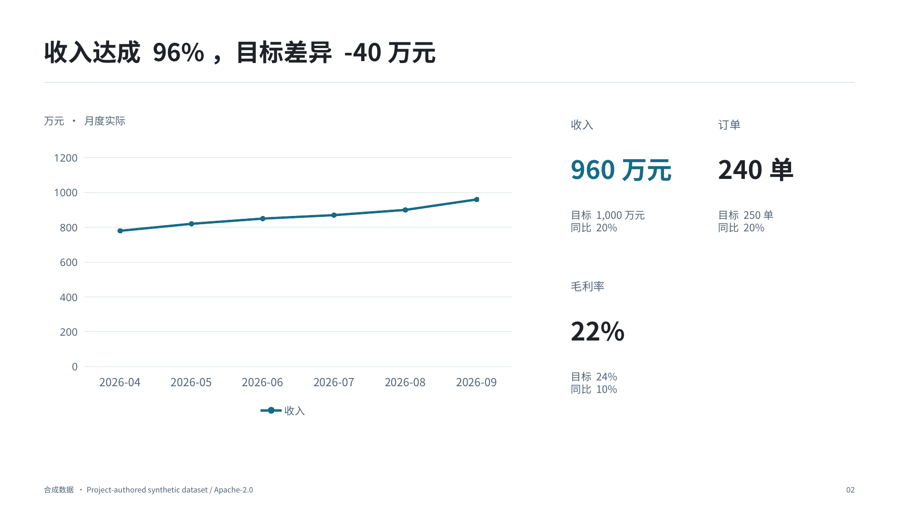
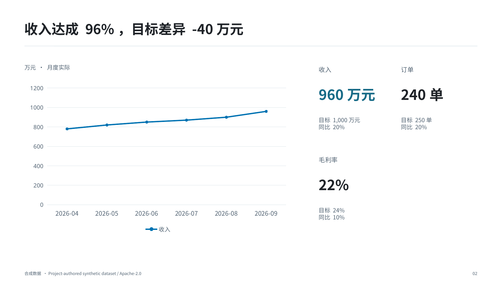

# V1.3 benchmark and visual evidence

[中文 README](../README.md) · [English README](../README.en.md) · [Quality scope](QUALITY_AND_VALIDATION.md)

All fixtures are clearly synthetic or project-authored. A–N below is a coverage map, not 14 independent proofs of business intelligence. The agent still judges claims, chart choice and decision relevance.

## Repeatable runs

```bash
npm test
npm run benchmark -- --render
npm run benchmark:v13
npm run showcase
npm run package:showcase
```

The legacy suite retains 15 scenarios. V1.3 adds a 96-cell matrix: six native families × two themes × eight cases (single, multi, long labels, percentages, negative, missing, large, dense). 72 cells are built/read back/rendered; 24 combinations are expected rejections; unsupported combinations are expected rejections, not successful renders. Supplemental stacked bar/column and explicit equal-width histograms are checked. Scatter/bubble/waterfall are NOT_SUPPORTED; no substitute is renamed as those families.

`npm run benchmark:v13` builds the current-version cases under `out/v1.3-showcase/`. A new output directory is allowed only under project out/system temp; replacement requires a previous owned benchmark marker, protecting unrelated files. Use `--baseline-root <exact-v1.2.1-source>` for the before/after run. No baseline is downloaded implicitly; absent baseline comparison stays NOT_RUN. `npm run showcase -- --reuse` refuses an outdated code fingerprint. Real image previews live in [docs/visual/v1.3](visual/v1.3/README.md).

## A–N coverage

| ID | Question | Evidence |
|---|---|---|
| A | Are multiple lines distinguishable? | Light/dark trends, native identities/paint/dash/marker and actual renders |
| B | Are grouped bars/columns comparable? | Actual/target/regions, native values and grouping |
| C | Are composition values/labels truthful? | Pie/doughnut single nonnegative totals, share/value formatting, negative/missing rejection |
| D | Does the dashboard retain units and comparisons? | Business gallery, typed KPI/trend/target and native table reconciliation |
| E | Are percentages distinct from pp? | Raw fraction/stored percent/pp tests and gallery cohort comparison |
| F | Are sales denominators/cohorts correct? | Same30-day mature cohorts, dedup and optional trial behavior; no causal inference |
| G | Does a histogram use real numeric bins? | Equal contiguous bins, counts and empty frequency bin; unequal-bin negative tests |
| H | Are actual time distances preserved? | ISO timeline, close-date label lanes and explicit duration |
| I | Are branches/roles preserved? | Bounded native branch/swimlane, edge labels, cycle/dangling-node rejection |
| J | Are dependencies inspectable? | Native DAG/roadmap, owner/date/status and declared ISO order |
| K | Are long titles and dense evidence readable? | Measured candidates, title_short/subtitle, dense native table and actual-page review |
| L | Is multi-document evidence retained? | Declared ledger, appendix disposition, redundancy candidate and claim coverage |
| M | Is the same content usable across themes? | Executive-dense, corporate and dark-executive gallery |
| N | Can evidence be traced to source/version? | Same-input scenario pairs, fingerprints, artifact/checksum manifests, docs/previews |

## V1.2.1 comparison

Business performance, sales conversion and project performance use byte-identical raw JSON for both versions. The baseline is source commit `fb55b1cc92e52923027c2a5ad405d3ee92b42f25` (v1.2.1). Each engine derives its own spec and PPTX from that input. The same host/runtime and current locked dependencies are used for the controlled source comparison; it is not a claim of byte-identical replay of a historical Office environment.

Inputs, original specs, native PPTX, scenes, renders, PDF/montage and QA remain in the optional showcase. Manifests record raw-input identity, numerical differences, source version and code fingerprint. Changed pixels are not automatically an improvement; independent review checks correct labels, units, missing months, series identification, title fit and useful business conclusions.

The same raw business input produces the two page-2 renders below. This page retains the original layout; the visible change is series styling. Broader curated V1.3 composition examples are separate authored cases, not an automatic rewrite of this page.

| v1.2.1 | v1.3 |
|---|---|
|  |  |

## Review and acceptance

The first visual review found crowded line labels, a line bridging missing data, overlong title/copy and category labels incorrectly replaced by time windows. Targeted repairs preserve data and create clearer roles, honest gaps, readable context and authored categories. Numeric readback also found a pie-share formatting error. Full-size matrix inspection additionally found a filled-area missing-value distortion and negative-label collision; the affected inputs are now rejected or repaired and the actual rerenders were inspected.

Automated matrix/contract PASS proves bounded data/structure behavior. Automated Vision/semantic meaning stays NOT_RUN; the separate [Codex visual record](evidence/v1.3/visual-review.json) documents actual reviewed scope and hashes. See [feasibility](FEASIBILITY_REVIEW.md) and the final acceptance record for executed counts and page scope. Native Windows/macOS/ARM64 PowerPoint and company/Agensi journeys remain separate unexecuted gates.
