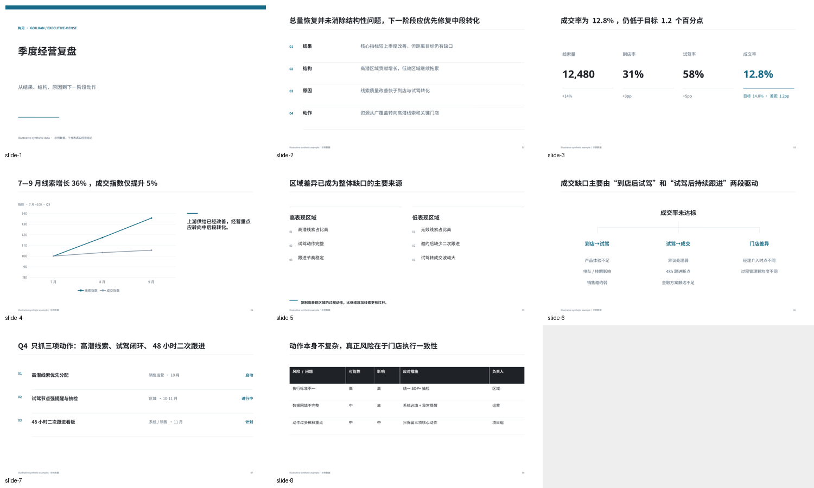
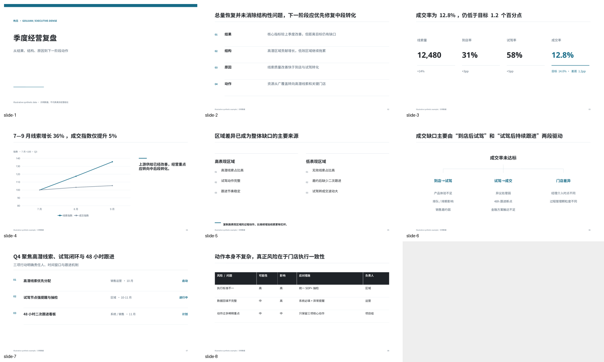
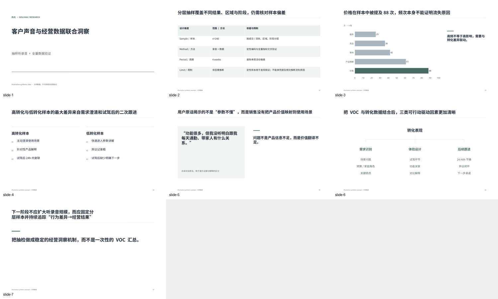
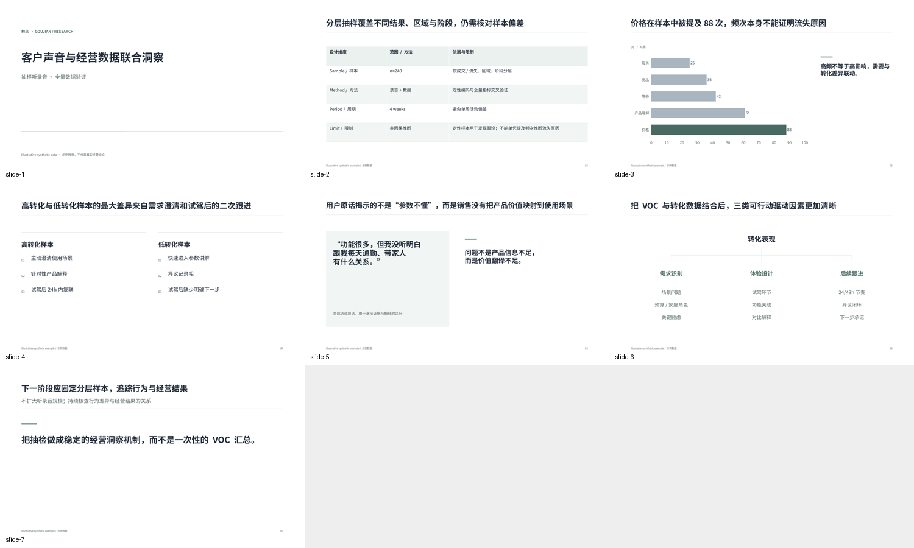
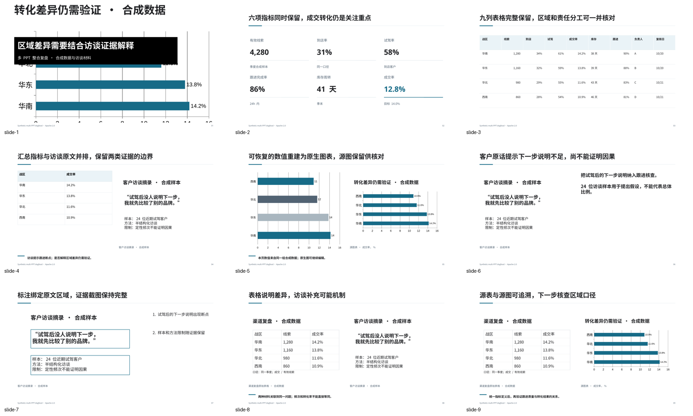
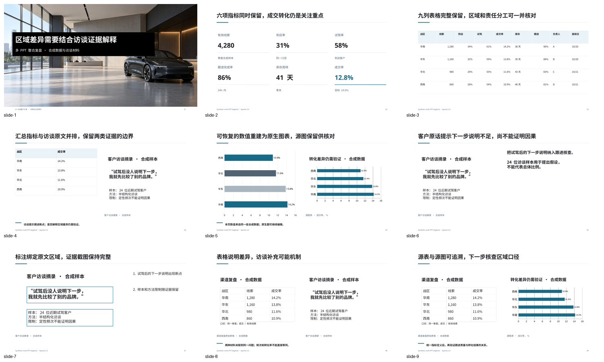

# GOUJIAN STRATEGY SLIDES V1.1

Historical engineering acceptance at `ddac321`; superseded for public release by [final release validation](V1_1_RELEASE_VALIDATION.md).

Theme: **Multimodal Composition & Visual Intelligence**. Engineering audit date: **2026-10-16**. Baseline: `8416d958` (v1.0.1; same V1.0 presentation engine, preserving the packaging patch).

**STATUS: V1.1 READY — documented, agent-assisted contract passed local acceptance**. This is a local engineering delivery, not a published GitHub Release. Source and all historical v1.0 tags remain distinct.

## Executed validation

| Check | Result | Evidence / scope |
|---|---|---|
| Legacy regression and schema/payload tests | PASS | npm test; original V1 contract retained |
| Python QA tests | PASS | Existing 6 tests + 7 V1.1 tests; Node assertions also cover native builds and Unicode |
| Example Spec | PASS | 12 scenarios |
| PPTX / native scenes | PASS | 12 scenario builds, 27-composition gallery, 9 native image semantic routes |
| Geometry / fonts | PASS | Linux installed Noto families; no claim about recipient glyph coverage |
| Spatial QA | PASS / allowed notes | Actual PPTX IDs, bboxes and z-order; known balanced two-line titles are notes |
| Native render | PASS | All 12 scenarios; LibreOffice + Poppler + Pillow |
| Vision | PASS for 3 acceptance decks | Business Review 8 slides, VOC 7, Multimodal Integration 9; reviewer records bind current PPTX hashes |
| Other scenario vision | NOT_RUN | Render success does not imply visual approval |
| Profiles | PASS build/render; manual comparison | 15 same-content variants, 3 full-size family checks; not 15 independent design systems |
| ZIP / clean install | PASS | Isolated venv/Pillow + npm install/test/example/multimodal build/render; runtime bytes matched source |
| Windows / macOS / PowerPoint | NOT_RUN | Linux verification only; other rendering stacks can differ |
| Company platform / GitHub V1.1 CI or Release | NOT_RUN | This contract does not request publishing or provide company-platform access |

Executed benchmark status and PPTX hashes: [benchmark summary](evidence/v1.1/benchmark-summary.json). Native QA and current reviewer records are in [evidence/v1.1](evidence/v1.1/). Runtime capabilities are recorded separately; missing LibreOffice explicitly yields VISUAL_QA=UNAVAILABLE, tested by regression.

## Permanent regression cases

| Case | Result | Actual check |
|---|---|---|
| A Duplicate section | PASS | One native section identity; matching title prefix merges, decorative duplicate suppresses; corroborated embedded marker retained, low-confidence pixel text never auto-deleted |
| B Screenshot/table occlusion | PASS | Serialized contained-image-over-table fixture fails SEMANTIC_OCCLUSION; valid panels pass |
| C Image/text contrast | PASS | Mixed black/white local sample requires scrim; final hero remains readable; protected evidence rejects destructive crop/mask/fade |
| D Detached image text | PASS | Embedded pixel text has source_asset/region/confidence/render_mode; editable interpretation is separate |
| E Six KPIs | PASS | Sixth value present in actual native text; seven fail explicit capacity; nine table columns preserved |
| F Regional repetition | PASS | Matching analytical_series id/metrics/task allows four consistent pages; unrelated task warns |
| G Long executive title | PASS | Measured shortening/title_short/subtitle; no tiny type; balanced English wrap allowed; oversized unbreakable title fails explicitly |
| H Title/divider | PASS | Subtitle/divider/body measured flow; injected collision fails; text/rule gap uses glyph height and vertical alignment |
| Unicode | PASS | Chinese, spaces, parentheses, &, ★ in spec and output filenames; asset paths resolve from spec directory |

## P0 acceptance mapping

Native assets/image-insight, provenance, scene relationships, duplicate marker fix, screenshot/table occlusion detection, six-KPI fidelity, local image contrast, title/subtitle hierarchy, measured text, divider flow, capability detection, exercised vision repair and synthetic dogfood have executed evidence above. Asset category interpretation and semantic rewriting are supplied by the AI agent; deterministic code enforces the supplied contract. General automatic classification/OCR/reasoning is not claimed.

## Dogfood: multiple enterprise PPT sources

Two project-authored source decks use editable channel tables, interview text and a native chart, with Unicode filenames. `scripts/create_v11_fixtures.js` renders screenshot derivatives; `inspect_pptx.py` records source PPTX SHA256, slide/shape identity and native evidence. The integration spec preserves screenshot source mappings and reconstructs recoverable numerical evidence through native panels. See [source inspection](evidence/v1.1/source-inspection.json).

- **V1.0 result:** actual preserved baseline rejects the multimodal spec as unsupported; six KPIs and nine-column tables exceed its old capacity. image-insight is explicitly DESIGNED, not silently supported.
- **V1.1 result:** 9-page integration deck builds/renders with native pictures, chart, tables, annotation, captions and separate interpretation; all four declared assets are used (asset coverage 100%), zero unresolved assets, detached annotations or semantic occlusions in the final QA.
- **Python-pptx postprocessing still required? NO.** Pillow processes raster derivatives before native PPTX serialization. No PPTX is reopened to insert images.

Asset coverage is not automatic proof that every conclusion in arbitrary sources was preserved. Source fidelity beyond the controlled fixture, ambiguous annotations, groups/SmartArt and master reconstruction remain PARTIAL. Real enterprise source files were not supplied; this is the explicitly allowed synthetic equivalent.

## Visual iteration

**Round 1:** chart screenshot used as a background was cropped and visually confusing; panel chart inherited Arial and rounded labels; VOC closing title split an expression; business action title mixed judgment with execution detail.

**Changes:** evidence screenshots remain contain/protected; a clearly labelled fictional showroom illustration tests the background path; local contrast selects native text color/scrim. Explicit chart fonts/number format, title_short/subtitle, measured header/body flow and source-bound document highlights replace the failures.

**Round 2:** three acceptance decks rendered again; no screenshot/table occlusion, title/divider collision, duplicate section marker or missing Chinese glyph observed. The six-KPI grid and nine-column table are complete. Full-size review found orphan fragments in quote/interpretation body copy.

**Final copyfit within round 3:** measured body balancing avoids punctuation starts, while author-supplied clause breaks preserve natural Chinese phrasing. VOC, training and multimodal decks were rebuilt/rerendered; changed pages and final acceptance montages were inspected. No further visual changes made.

| Before | Final |
|---|---|
|  |  |
|  |  |
|  |  |

Acceptance answers: no accidental evidence occlusion observed; required management titles are one line or deliberate balanced exceptions; no title/subtitle/divider conflict; one section marker; arrows are intentional relationships, no unexplained glyphs; screenshots are complete/readable at native viewing size; foreground text contrast is clear; installed/fallback font paths execute. Page rhythm varies across comparison, chart, table, framework, image and action pages. Aesthetic judgment is bounded reviewer evidence, not a universal guarantee against an “AI PPT” appearance.

## Profile audit

Eight named blue-family profiles were inspected in the 15-profile comparison: executive-clean, executive-dense, consulting, corporate, finance, sales, product-tech, dark-executive. Actual differences include size/density/margins, divider, table banding/header, chart grid and cover treatment. V1.1 adds image gutter/caption/border controls used by the renderer.

**Distinct broad families: 3** (light data/dense, sparse editorial/launch, dark). **Merged: 0; added: 0; improved: 15** through shared measured headers and real image tokens. Variants are not independent rendering systems. [Comparison montage](visual/v1.1/profiles-montage.png), [executed profile status](evidence/v1.1/profile-summary.json).

## Claims and remaining limits

| Claim | Status | Boundary |
|---|---|---|
| Native multimodal create / image-insight | PROVEN | Local raster assets and bounded editable/native compositions |
| Asset interpretation | PARTIAL | Agent-supplied categories/provenance; no built-in classifier/OCR |
| Edit / Rebuild / reference learning | PARTIAL | Text-node edit, richer inspection/style statistics and agent reconstruction; no lossless arbitrary merge |
| Title reasoning | PARTIAL | Real measurement/flow, bounded deterministic cleanup and author/agent rewrite; no universal conclusion-preserving summarizer |
| Scene/spatial QA | PROVEN within explicit scenes | Actual native bounds/order and linked semantics; arbitrary imported intent remains unknown |
| Vision / repair | PARTIAL product automation; exercised workflow PROVEN | Explicit reviewer + agent repair; no autonomous vision model or deterministic repair service |
| Font resolution | PROVEN on Linux / PARTIAL portability | Installed families and substitution trace; no embedded fonts or complete glyph proof |
| Multi-renderer readiness | DESIGNED | JSON asset/provenance/scene contracts independent of PptxGenJS; HTML not implemented |

Top strengths: native source-aware multimodal construction; measured and bounded hierarchy/fidelity; executed negative tests plus real visual repair evidence.

Remaining limits: general source understanding/reasoning remains agent-assisted; arbitrary PPTX/SmartArt/master reconstruction is partial; glyph/render differences and exact table/chart text fit still require visual review. This delivery includes no HTML, animations, company-specific fork, new profile/template expansion or autonomous OCR/vision service.

**Recommendation: READY for the documented Agent-assisted V1.1 workflow.** No claim of autonomous general understanding, lossless editing or public release.
