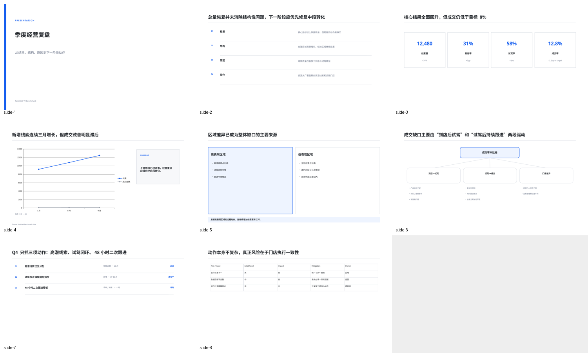
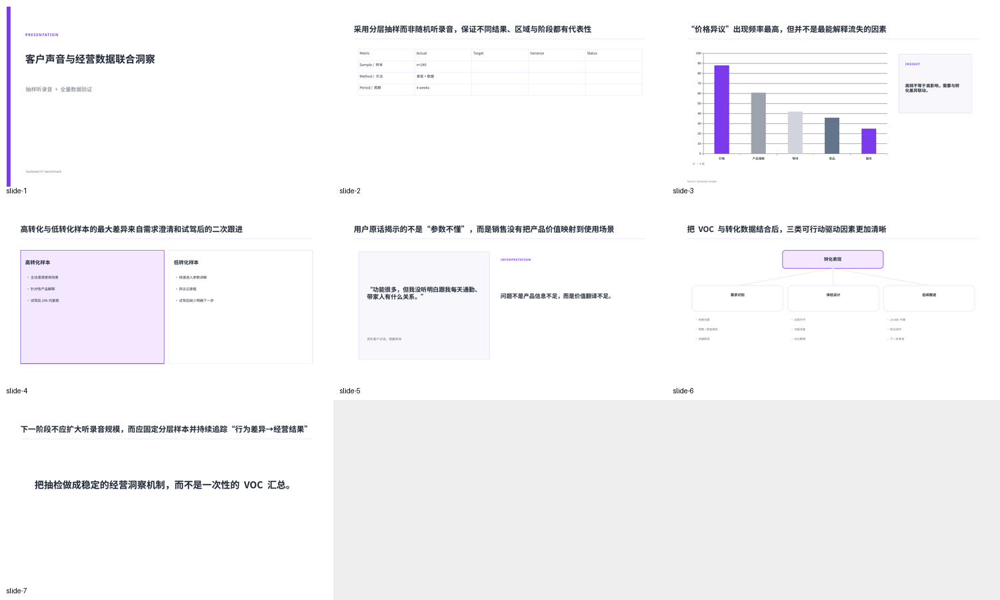
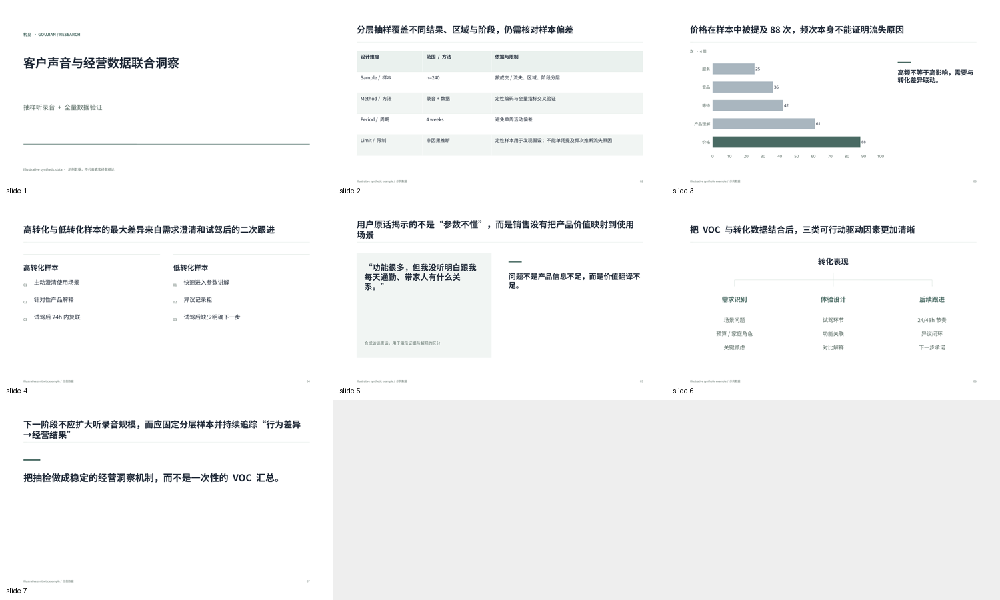
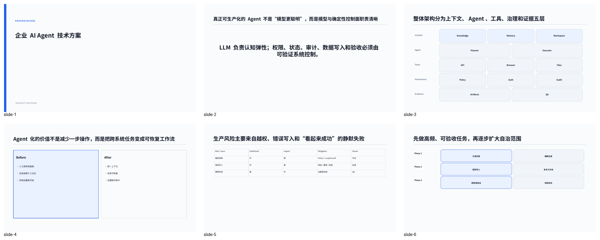
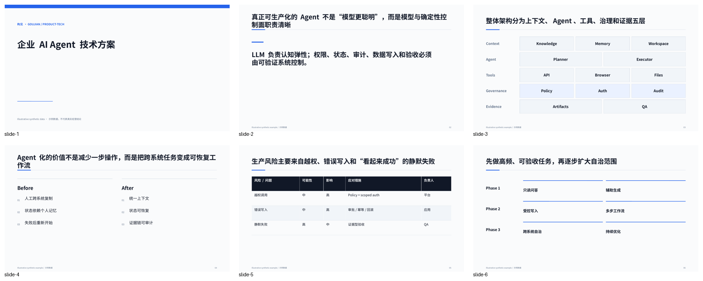

# Visual review and iteration

Reviewed on 2026-10-14 by Codex through rendered slide images. This is a vision-agent assessment, not independent human approval or proof of universal aesthetics. All examples contain synthetic data.

## Round 1: original candidate

Built and rendered Business Review (8 pages), VOC/Research (7) and Technical/AI Proposal (6). Inspected all three montages and selected full-size pages.

The main problems were small body text, repetitive enclosed cards, weak numerical emphasis, default-looking charts and inconsistent semantic fidelity. The business trend mixed lead counts with a transaction index, obscuring interpretation. Research-method notes and sampling limitations were lost. Profiles exposed more design promises than the renderer actually used.

## Round 2: substantive redesign

Rebuilt and rendered the same three scenarios after changing shared rendering primitives and profiles:

- Open KPI strips, restrained comparison columns, action rows and clearer hierarchy connectors replaced unnecessary boxes.
- Larger body/table/chart type, stable margins and title rules improved scanning and Chinese/English balance. Key numbers and the single most important series/category received the accent.
- Business trend data were normalized to a clearly labeled July=100 baseline; target variance was corrected. Bar charts use a zero baseline and explicit units.
- Research method tables retain limitations; frequency is no longer described as causal proof. Quotes identify their synthetic origin.
- Governance receives emphasis in technical architecture; tables use deliberate headers, banding and numeric alignment.

The result was visibly clearer: the conclusion, focal evidence and action can be located without reading every text block. The deck now varies among summary, metric, chart, comparison, hierarchy, table, evidence and decision pages. This is an observed qualitative improvement, not a numerical design score.

## Round 3: bounded final corrections and broader coverage

Built and rendered all 10 scenarios (60 pages), a 23-recipe composition gallery and a common three-page probe for every profile (45 pages). Reviewed all benchmark montages, the composition montage, the profile contact sheets, and full-size research/chart/risk/edited-cover pages.

Corrected matrix labeling, portfolio spacing, quantitative funnel proportions and retention labels, title wrapping, native chart font declarations and dark-theme legend contrast. Updated misleading funnel and launch wording. The final product-launch wording was rendered and inspected again after the correction.

No obvious clipping, missing Chinese glyphs or accidental peer overlaps were observed in these samples. The sparse statement/transition pages are intentional; most examples remain short demonstrations, not fully populated board packs. Footnotes are secondary reading material, not primary projected text.

## Before / after evidence

### Business Review

Before:

After:

### VOC / Research

Before:

After:

### Technical / AI Proposal

Before:

After:

The [benchmark evidence](evidence/benchmark-summary.json) records exact local PPTX hashes. [Review records](evidence/reviews/) bind each inspection to its artifact and complete page range. Rebuilding produces new artifacts and requires new reviews; a stored pass is not transferable to another file.

## V1.1 / V2 priorities

V1.1: content-aware text measurement, calibrated dense-table fixtures, reliable complex chart semantics, profile-specific diagram sizing and real long-form user decks. Native PowerPoint/Windows/macOS comparison needs dedicated environments and reviewers.

V2: a second renderer and reusable layout measurement, richer existing-deck reconstruction, and assisted visual repair informed by actual user failures. No deterministic automatic visual repair is claimed for V1.
